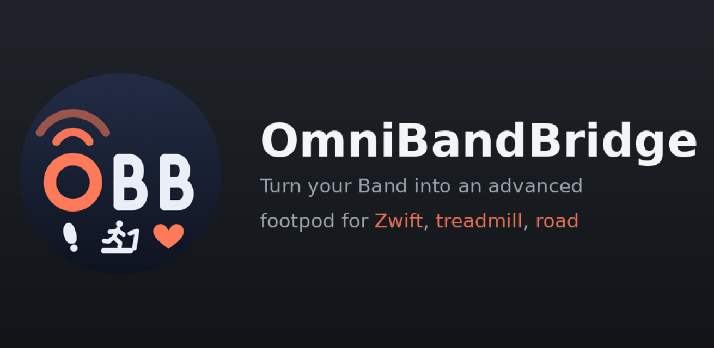

  

# Community & issue tracker

**Free your Band!** OmniBandBridge (OBB) acquires real-time running & walking data (cadence, speed, stride) and retransmits it using open protocols (BLE RSC / TCP) to third party platforms like Zwift. Running & walking dynamics (included advanced parameters like GCT - Ground Contact Time, impact, VO - Vertical Oscillation, VR - Vertical Rate, etc.) are fused with data from other sensors like Heart Rate and treadmill's belt speed & incline (FTMS sensor or manual) to compute a personalized metabolic-power metric. All sensor data are exported into your workouts for AI-based analyses.

SUPPORTED SOURCES FOR RUNNING/WALKING DYNAMICS
- Xiaomi Mi Band 8, 9 and 10 (wrist & footpod mode) and Pro/Active variants (wrist only)
- Garmin watches (native for devices supporting "Virtual Run" activity, via Garmin IQ OBB Companion App for devices not supporting "Virtual Run")  
- Atlas sensor embedded in Under Armour HOVR shoes

> ℹ️ **This repository has no source code.** OmniBandBridge is closed-source. This is the **public community & issue tracker**: the place to report bugs, request features, ask questions and follow the roadmap.

## 🐞 Report a bug
Open a **[New issue](../../issues/new/choose) → Bug report**. Please include your app version, phone/OS, Mi Band model and steps to reproduce.
⚠️ **Remove your Auth key and any personal data** from logs/captures before posting.

## 💡 Request a feature / share an idea
- Concrete request → **[New issue](../../issues/new/choose) → Feature request**.
- Open-ended idea you'd like others to vote on → **[Discussions → Ideas](../../discussions/categories/ideas)**.

## 💬 Questions & help
Use **[Discussions → Q&A](../../discussions/categories/q-a)** (not issues).

## 🔗 Links
- Website & docs: https://omnibandbridge.com
- Privacy policy: https://omnibandbridge.com/privacy *(coming soon)*
- Download: *(Google Play — coming soon)*

---
*OmniBandBridge is not affiliated with Xiaomi, Zwift or any third party. Product names and trademarks belong to their respective owners.*
